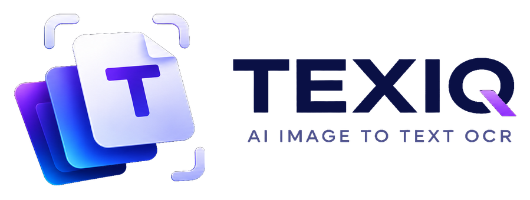

# Texiq

Paste a screenshot, photo or PDF and get the text: English, Arabic, Malayalam, Hindi, Tamil and other Indian languages.

- **Fast** reads in the browser with Tesseract: free, instant, and the image never leaves the device.
- **Google Vision** for Indian languages, phone photos, two-column pages and Arabic: each user adds their own Google Cloud API key (the first 1,000 pages a month are free).
- PDFs with real text are read without OCR; scanned pages go to OCR.
- Batches and whole folders, a review view that highlights unsure words, light and dark mode.

It's a static site: one `index.html` and an `assets` folder. No server or build step.

## Publish on GitHub Pages

1. Create a new repository on GitHub, for example `texiq`.
2. Upload everything in this folder (`index.html`, `assets/`, `README.md`, `.nojekyll`) to the repository root.
3. In the repository: **Settings → Pages → Build and deployment → Source: Deploy from a branch**, branch `main`, folder `/ (root)`, **Save**.
4. After a minute the site is live at `https://<your-username>.github.io/texiq/`.

## Using Google Vision on the live site

The key is typed into the page and kept in that browser only; it is never part of these files.

1. In Google Cloud: enable **Cloud Vision API**, then **Credentials → Create credentials → API key**.
2. Restrict the key: **API restrictions → Cloud Vision API**, and **Application restrictions → Websites →** `https://<your-username>.github.io/*`.
3. Open the site, click **Google**, paste the key and save.

Because the key works only from your site's address and only for Vision, it can't be used elsewhere. A budget alert in **Billing → Budgets & alerts** emails you if anything is ever charged.

Visitors who don't have a key still get Fast mode.

## Credits

[Tesseract.js](https://github.com/naptha/tesseract.js) (Apache-2.0) · [pdf.js](https://github.com/mozilla/pdf.js) (Apache-2.0) · [UTIF.js](https://github.com/photopea/UTIF.js) (MIT) · [heic2any](https://github.com/alexcorvi/heic2any) (MIT) · [Noto fonts](https://fonts.google.com/noto) (OFL)
